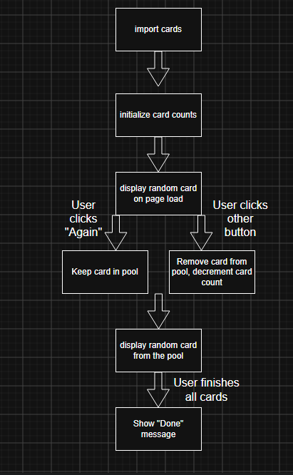

A. Script Idea

I will generate 20 example flashcards with AI and then when the page opens it will display
one of them at random. If the user clicks "Again", it will keep the card in the pool and
display a different one. If the user clicks one of the other buttons, it will remove the 
card from the pool and decrease the number of cards in the top right. 

B. Goals

This script will enhance user experience by simulating the SRS system that would
be in a real SRS flashcard app.

C. Task Breakdown

- Load the cards json and put all cards into a pool
- Initialize the card count numbers at the top right
- On page load, choose a random card and display it
- If the user clicks "Again", keep the card in the pool and show a new card
- If the user clicks one of the other buttons, remove the card from the pool,
show a new card, and decrement the card count at the top right
- Once there are no more cards, show a "Done" message

D. Flowchart

